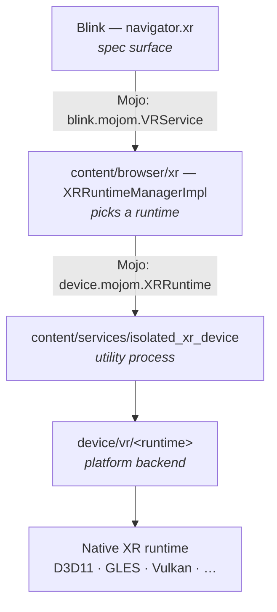
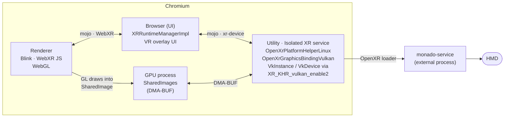
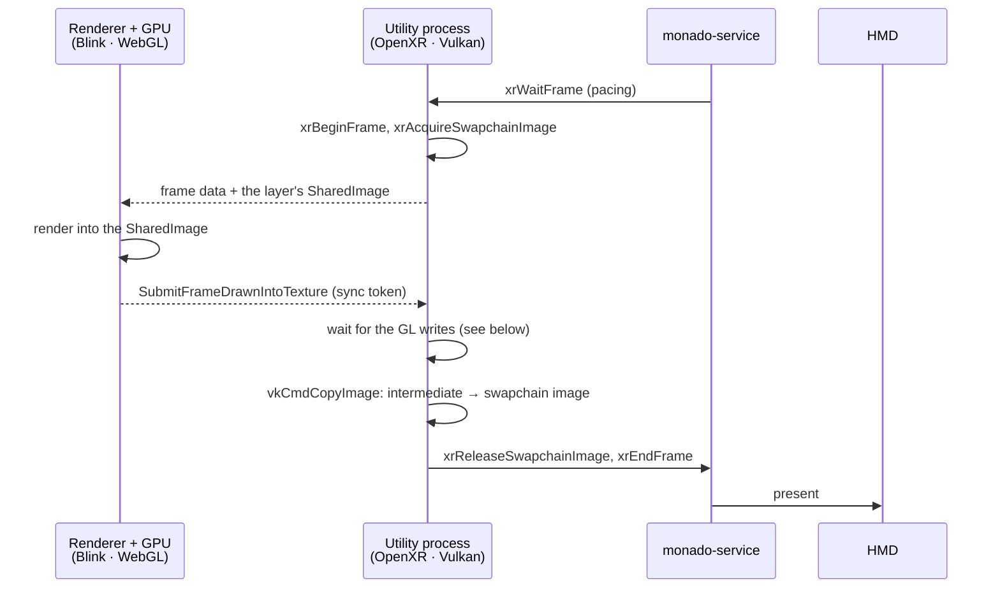
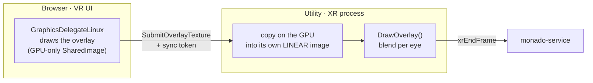

<p align="center">
  
</p>

# WebXR over OpenXR on Linux

WebXR `immersive-vr` for Linux builds of Chromium, through the OpenXR API.
Verified against [Monado], the open-source reference OpenXR runtime.

Most of this work is now part of upstream Chromium: OpenXR on Linux, its
sandbox and its frame synchronization have landed, and the first parts have
shipped on the stable channel. This repository carries the **seven patches
that are not merged yet**: WebXR features on top of the Linux backend, the
in-headset browser overlay, and turning OpenXR on by default.

[Monado]: https://monado.dev/

## Status

As of 2026-10-18. Milestones and dates come from
[chromiumdash](https://chromiumdash.appspot.com/schedule); a change ships in
the milestone that was on trunk when it landed.

### Merged upstream

| Change | Old patch | Gerrit | Landed on main | Milestone | Linux stable |
| --- | --- | --- | --- | --- | --- |
| vr: fix re-entrant OpenXR session-end crash | `0009` | [8080622](https://crrev.com/c/8080622) | `8dab052`, 2026-07-17, r1663964 | M152 | Released in 152.0.7977.64 (2026-08-25) |
| vr: fix OpenXR session-child use-after-free on teardown | `0008` | [8080621](https://crrev.com/c/8080621) | `9b872f8`, 2026-07-17, r1663970 | M152 | Released in 152.0.7977.64 (2026-08-25) |
| vr: add WebXR-over-OpenXR support on Linux | `0001`–`0004`, `0010` | [8121052](https://crrev.com/c/8121052), reland [8210979](https://crrev.com/c/8210979) | `ff8f5db`, 2026-08-25, r1685828 | M154 | Released in 154.0.8037.57 (2026-09-22) |
| sandbox: skip uprobe/uretprobe in SandboxBPF.SyntheticPolicy | — | [8304617](https://crrev.com/c/8304617) | `0f1b5f6`, 2026-08-28, r1688157 | M154 | Released in 154.0.8037.57 (2026-09-22) |
| vr: run the XR device service in the sandbox on Linux | `0005`, `0006` | [8127854](https://crrev.com/c/8127854), reland [8441736](https://crrev.com/c/8441736) | `e0f937b`, 2026-09-25, r1705341 | M156 | Will be released in M156 (stable 2026-10-20) |
| vr: enable the OpenXR runtime on Linux | part of `0001` | [8132979](https://crrev.com/c/8132979) | `71d17e1`, 2026-09-29, r1707175 | M157 | Will be released in M157 (stable 2026-11-03) |
| vr: let the XR sandbox read Flatpak's GPU drivers | — | [8498995](https://crrev.com/c/8498995) | `5153d78`, 2026-10-02, r1710366 | M157 | Will be released in M157 (stable 2026-11-03) |
| vr: avoid glFinish() in the OpenXR render loop on Linux | follows up `0002` | [8471692](https://crrev.com/c/8471692) | `acc4a4d`, 2026-10-12, r1717111 | M157 | Will be released in M157 (stable 2026-11-03) |

Notes:

- The first landing of the core change (`de6885c`, 2026-08-04) was reverted
  the same day: its new unit tests failed the Linux CFI bot's `cfi-icall`
  check. The reland excludes the OpenXR loader calls from that check.
- The first landing of the sandbox change (`5b3e4fb`, 2026-09-21) was
  reverted for a Cast build break; the reland gates it on `enable_vr`.
- The SyntheticPolicy change fixes a sandbox unit test that newer kernels
  broke; the sandbox change's tests needed it.
- M154 and M155 build the Linux backend, but nothing reaches it yet. From
  M157 it works end to end with `--enable-features=OpenXR`; the feature stays
  off by default on Linux until patch `0007` or a launch decision. From M156
  the OpenXR service runs in its own sandbox.

### Not merged yet (the patches in this repository)

| Patch | Change | Gerrit | Review state | Earliest stable |
| --- | --- | --- | --- | --- |
| `0001` | vr: support WebXR Layers with OpenXR on Linux | [8471693](https://crrev.com/c/8471693) | In review (patch set 13), two Code-Review +1 | M158 (2026-11-17) if it lands before the M158 branch point on 2026-10-26, else M159 (2026-12-08) |
| `0002` | webxr: support frame rate control with OpenXR | [8473130](https://crrev.com/c/8473130) | In review (patch set 12) | M158 or M159, as above |
| `0003` | webxr: add XRFrame.predictedDisplayTime | [8510029](https://crrev.com/c/8510029) | In review (patch set 11) | M158 or M159, as above |
| `0004` | webxr: add XRSession.trackedSources and XRInputSource.skipRendering | [8510030](https://crrev.com/c/8510030) | In review (patch set 11) | M158 or M159, as above |
| `0005` | webxr: support WebGPU sessions with OpenXR on Linux | [8510031](https://crrev.com/c/8510031) | In review (patch set 11) | M158 or M159, as above |
| `0006` | vr: show the WebXR browser overlay on Linux | — | Not uploaded yet | M159 (2026-12-08) at the earliest |
| `0007` | vr: enable OpenXR by default on Linux | — | Not uploaded yet; needs a launch decision by the OpenXR owners | After the launch review |

The patches are stacked in this order, and each Gerrit change depends on the
one before it.

### Where the old `0001`–`0010` went

The previous version of this repository carried ten patches on Chromium
`b3323dffec`. All of them are gone from this repository:

| Old patch | Now |
| --- | --- |
| `0001` WebXR over OpenXR on Linux | Upstream (M154, M157). The default-on part is the new `0007`. |
| `0002` glFinish fallback without a GPU fence | Upstream (M154), then replaced by the DMA-BUF fence wait (M157). |
| `0003` BGRA format and no SCANOUT usage | Upstream (M154), as a fixed BGRA-first format list. The `--webxr-openxr-swapchain-format` switch was dropped in review. |
| `0004` `checkout_openxr` on Linux | Upstream (M154). |
| `0005` sandbox | Upstream (M156), with a stricter policy than the patch had. |
| `0006` sandbox library pre-warming | Upstream (M156), in the sandbox change. |
| `0007` in-headset overlay UI | Rewritten as the new `0006` for the current upstream code. |
| `0008` session-child use-after-free | Upstream (M152). |
| `0009` re-entrant session end | Upstream (M152). |
| `0010` GBM shared buffer | Upstream (M154), for the WebXR images. The overlay no longer needs it. |

## What the patches do

Apply `0001` through `0007` in order.

- **`0001` WebXR Layers.** The Vulkan binding keeps intermediate images per
  layer, so pages can use projection, quad, cylinder and equirect layers
  (`XRWebGLBinding`). The runtime flips projection layers. It flips the
  other types too if it supports `XR_FB_composition_layer_image_layout`;
  otherwise the binding flips them while copying. Cube layers are not
  supported. On Linux the `layers` feature is offered whenever the binding
  supports layers, and a layer of an unsupported type stays inactive. Monado
  has no cube layers and SteamVR has none of the extension layer types.
- **`0002` Frame rate.** `XRSession.frameRate`, `supportedFrameRates` and
  `updateTargetFrameRate()` use `XR_FB_display_refresh_rate`, with
  `frameratechange` events. This is on all OpenXR platforms; runtimes
  without the extension behave as before. Behind the `WebXRFrameRate` Blink
  feature.
- **`0003` `XRFrame.predictedDisplayTime`.** The OpenXR predicted display time
  of each frame, converted to the page's clock. Behind `WebXRSpecParity`.
- **`0004` `XRSession.trackedSources` and `XRInputSource.skipRendering`.**
  Input sources without a primary action go to `trackedSources` for sessions
  that request `tracked-sources`. Behind `WebXRSpecParity`.
- **`0005` WebGPU sessions.** WebGPU cannot write to the DMA-BUF images the
  Linux backend shares, so `XRGPUBinding` projection layers draw into an image
  of their own, which is copied and scaled into the layer at the end of the
  frame. Behind the `WebXRWebGPUBinding` feature.
- **`0006` In-headset browser overlay.** Permission prompts and capture
  indicators shown during an immersive session appear in the headset. See
  [VR browser overlay UI](#vr-browser-overlay-ui).
- **`0007` OpenXR on by default.** Turns the `OpenXR` feature on for Linux, as
  on Windows, so `--enable-features=OpenXR` is not needed.

## Chromium WebXR architecture across platforms

WebXR in Chromium has a fixed top half that is the same on every platform, and
a platform-specific bottom half under `device/vr/` that drives the XR runtime:



| Platform | immersive-vr runtime | immersive-ar runtime | inline fallback | Source dir(s) |
| --- | --- | --- | --- | --- |
| Windows | OpenXR (D3D11 binding) | OpenXR (D3D11 binding) | orientation sensor | `device/vr/openxr/{,windows}/` |
| Linux | OpenXR (Vulkan binding) | — | orientation sensor | `device/vr/openxr/{,linux}/` |
| Android | OpenXR (GLES binding) or Cardboard | OpenXR (GLES binding) or ARCore | orientation sensor | `device/vr/openxr/{,android}/`, `device/vr/android/` |
| macOS / iOS / ChromeOS | not supported | not supported | orientation sensor (where applicable) | — |

The OpenXR ports share `device/vr/openxr/`: `OpenXrApiWrapper` (session,
swapchains, frame loop), `OpenXrPlatformHelper` (instance creation and
extensions; `OpenXrPlatformHelperLinux` on Linux) and `OpenXrGraphicsBinding`
(GPU interop):

| Platform | Graphics binding | Graphics API |
| --- | --- | --- |
| Windows | `OpenXrGraphicsBindingD3D11` | Direct3D 11 |
| Android | `OpenXrGraphicsBindingOpenGLES` | OpenGL ES |
| Linux | `OpenXrGraphicsBindingVulkan` + `OpenXrVulkanContext` | Vulkan |

Inline (non-immersive) sessions always use the orientation-sensor runtime under
`device/vr/orientation/`; OpenXR is not involved.

## Linux path in detail

Chromium talks to the OpenXR runtime (Monado here) from the sandboxed XR
utility process, which owns the `VkInstance`/`VkDevice` and the OpenXR session.



Each layer has one intermediate image per swapchain image. It is a DMA-BUF
that the GPU process sees as a `SharedImage` (the page draws into it with
WebGL) and the XR process sees as a `VkImage`:

- The XR process first asks the GPU process for an Ozone/GBM native pixmap
  and imports its DMA-BUF into Vulkan, honoring its DRM modifier.
- Where Ozone cannot allocate native buffers (X11 by default, or headless),
  it allocates `LINEAR` exportable `VkImage`s itself and the GPU process
  imports them.

Per frame:



The XR process waits for the page's GL writes in one of three ways:

1. With `GL_CHROMIUM_gpu_fence`, it takes a GPU fence and waits on it in
   Vulkan.
2. Otherwise it flushes, then waits on the write fence the kernel attached to
   the DMA-BUF. It exports that fence as a sync file and imports it as a
   `VkFence` (Linux 6.0 and newer).
3. If no write is pending, it falls back to `glFinish()`.

## Graphics APIs: where GL is used and where Vulkan is used

Everything the page and the browser *draw* is GL; everything handed to the
OpenXR runtime is Vulkan; they meet at shared DMA-BUFs.

| Part | Graphics API | How |
| --- | --- | --- |
| WebXR content (the page) | GL — WebGL | Blink draws into the layer's `SharedImage` over the GL command buffer. |
| WebGPU content (`0005`) | WebGPU | Drawn into an image of its own, then copied into the layer's `SharedImage` over the raster interface. |
| Browser overlay UI (`0006`) | GL — command-buffer GLES2 | `GraphicsDelegateLinux` draws the `chrome/browser/vr` scene into a `SharedImage`. |
| OpenXR graphics binding | Vulkan | `OpenXrVulkanContext` creates the `VkInstance`/`VkDevice` through `XR_KHR_vulkan_enable2`. |
| Copy and overlay blend | Vulkan | `vkCmdCopyImage`, and a small graphics pipeline for the overlay, then `xrEndFrame`. |

`--use-angle=vulkan` does not change this: ANGLE only changes how the GPU
process executes the GL, and which of the sync paths above is used.

## Base commits

| Component | Remote | Base |
| --- | --- | --- |
| Chromium | `https://chromium.googlesource.com/chromium/src.git` | `ce7b69d7c8d5bdd1b4d2814777fb5818865bb710` (main, 2026-10-18, r1721490, 158.0.8111.0) |
| Monado | `https://gitlab.freedesktop.org/monado/monado.git` | `v25.1.0` or newer (verified at `v25.1.0-849-gded98428a`) |

The patches also apply cleanly to main as of `269a3c8a64d27` (2026-10-18). On a
newer base, `git am --3way` usually resolves conflicts.

## Prerequisites

Packages (Debian/Ubuntu):

```bash
sudo apt install -y \
  build-essential git cmake ninja-build pkg-config python3 \
  libvulkan-dev libvulkan1 vulkan-tools mesa-vulkan-drivers \
  libegl-dev libgl-dev libglx-dev \
  libx11-dev libxcb1-dev libxrandr-dev libxinerama-dev \
  libwayland-dev wayland-protocols \
  libhidapi-dev libusb-1.0-0-dev libudev-dev \
  libbsd-dev libdbus-1-dev libsystemd-dev libglvnd-dev
```

You also need Chromium's [`depot_tools`] on `PATH`.

[`depot_tools`]: https://www.chromium.org/developers/how-tos/install-depot-tools/

## 1. Build and run Monado

```bash
git clone https://gitlab.freedesktop.org/monado/monado.git
cd monado
cmake -B build -G Ninja \
  -DCMAKE_BUILD_TYPE=RelWithDebInfo \
  -DXRT_HAVE_OPENGL=ON \
  -DXRT_HAVE_VULKAN=ON \
  -DXRT_FEATURE_SERVICE=ON
ninja -C build
```

Start the service and leave it running:

```bash
rm -f /run/user/$(id -u)/monado_comp_ipc
./build/src/xrt/targets/service/monado-service
```

With no headset attached, Monado uses its simulated HMD, so the whole path can
be tested without hardware. Point OpenXR applications at it:

```bash
export XR_RUNTIME_JSON=$PWD/build/openxr_monado-dev.json
```

Rebuild all of Monado when you update it: the service and the client library
must come from the same build, or clients get `XR_ERROR_RUNTIME_UNAVAILABLE`.

## 2. Fetch Chromium

```bash
mkdir chromium && cd chromium
fetch --nohooks chromium
cd src
git checkout ce7b69d7c8d5bdd1b4d2814777fb5818865bb710
gclient sync
./build/install-build-deps.sh
```

`gclient sync` fetches the OpenXR loader (`third_party/openxr`) on Linux by
default.

## 3. Apply the patches

```bash
git am /path/to/chromium-webxr-linux/0*.patch
```

On a newer base, use `git am --3way` and resolve any conflicts. The patches do
not change `DEPS`, so no second `gclient sync` is needed.

Without the patches, Chromium M157 or newer (beta now, stable on 2026-11-03)
works with `--enable-features=OpenXR`, but without the layers, frame rate,
WebGPU and overlay features.

## 4. Build Chromium

```bash
gn gen out/Default --args='is_debug=false is_component_build=true symbol_level=1'
autoninja -C out/Default chrome
```

OpenXR is enabled in the build on Linux by default. To also build the tests:

```bash
autoninja -C out/Default device_unittests vr_common_unittests
```

## 5. Run and verify

With `monado-service` running:

```bash
XR_RUNTIME_JSON=/path/to/monado/build/openxr_monado-dev.json \
./out/Default/chrome \
  --use-angle=vulkan \
  --vmodule='*openxr*=1' --enable-logging=stderr \
  --user-data-dir=/tmp/chrome-xr-test-profile \
  "file:///path/to/chromium-webxr-linux/tests/webxr-test.html" \
  2>&1 | tee /tmp/chrome-xr.log
```

- Without patch `0007`, add `--enable-features=OpenXR`.
- A locally built `chrome` may also need `--no-sandbox`, or the AppArmor
  profile from the [Sandbox note](#sandbox-note). That concerns Chromium's
  base sandbox only; the OpenXR service runs in its own sandbox either way.
- Extra features: `--enable-blink-features=WebXRFrameRate` (`0002`),
  `--enable-blink-features=WebXRSpecParity` (`0003`, `0004`), and
  `--enable-features=OpenXR,WebXRWebGPUBinding` (`0005`).

On the page:

1. The **"immersive-vr supported"** line should be green. If it says *NOT
   supported*, Chromium did not find the OpenXR runtime; see
   [Filtering the log](#filtering-the-log).
2. Click **Enter VR**: Monado shows the page's dark-blue clear color.
3. Trigger a permission request or a capture from the page; each has a
   keyboard shortcut. It appears in the headset (`0006`), and you answer it in
   the desktop dialog.
4. Press `Esc` or click **Exit VR**.

The Immersive Web samples also work, for example
<https://immersive-web.github.io/webxr-samples/immersive-vr-session.html> and
<https://immersive-web.github.io/webxr-samples/layers-samples/>.

<p align="center">
  
  <br>
  <em>Immersive Web's <code>reduced-bind-rendering</code> sample rendering
  stereo through Chromium → OpenXR → Monado.</em>
</p>

### GPU backend — `--use-angle=vulkan`

`--use-angle=vulkan` is recommended but not required. It gives the GPU process a
real GPU fence (`GL_CHROMIUM_gpu_fence`), so the XR process waits on the GPU
instead of the CPU. Without it, the default ANGLE backend depends on the Ozone
platform (observed on AMD/Mesa):

| Ozone platform | Default ANGLE backend | `GL_CHROMIUM_gpu_fence` | Wait used by the XR process |
| --- | --- | --- | --- |
| Wayland | OpenGL ES on EGL | yes | GPU fence |
| X11 | desktop OpenGL on GLX | no | DMA-BUF write fence, else `glFinish()` |

The difference comes from the same ordered display list resolving differently:
`ui/gl/init/gl_display_initializer.cc` tries ANGLE's desktop-GL display first,
which ANGLE implements with GLX on X11 but with EGL on Wayland. Mesa exposes
`EGL_ANDROID_native_fence_sync`, which the GPU fence needs, only on EGL.

Add `--vmodule='*openxr_render_loop*=1'` and look for
`GL_CHROMIUM_gpu_fence supported=` to see which applies.

### Window system — X11 and Wayland

Both `--ozone-platform=x11` and `--ozone-platform=wayland` work and render at
the same rate. They differ in how the shared images are allocated:

- **Wayland:** Ozone allocates GBM native pixmaps.
- **X11:** Ozone allocates native buffers only with
  `--enable-native-gpu-memory-buffers`, so the XR process allocates `LINEAR`
  images instead.

Monado's own window is unrelated: it gets frames over its IPC socket.

### Filtering the log

```bash
grep -iE 'openxr|xrCreate|XR_ERROR|xrGetSystem|vulkan' /tmp/chrome-xr.log
```

| Log line | Meaning | Fix |
| --- | --- | --- |
| `xrCreateInstance ... XR_ERROR_RUNTIME_UNAVAILABLE` | Monado not running, or service and client from different builds | Start `monado-service`; rebuild all of Monado |
| `xrCreateInstance ... XR_ERROR_EXTENSION_NOT_PRESENT` | Runtime lacks `XR_KHR_vulkan_enable2` | Build Monado with `-DXRT_HAVE_VULKAN=ON` |
| `Failed to load libvulkan.so.1` | No Vulkan loader or driver | `sudo apt install libvulkan1 mesa-vulkan-drivers` |
| `xrGetSystem ... XR_ERROR_FORM_FACTOR_UNAVAILABLE` | No HMD | Connect one, or use Monado's simulated HMD |

### `chrome://webxr-internals`

Lists runtimes, sessions and errors. Enable *WebXR Internals Debugging Page*
in `chrome://flags`, then *Internal Debugging Pages* at the bottom of
`chrome://chrome-urls`, and open `chrome://webxr-internals`.

## Sandbox note

The OpenXR service runs **sandboxed**; this is upstream since M156. It has its
own sandbox type (`kXrCompositing`) and forks from the unsandboxed zygote:

- A pre-sandbox hook starts a broker for the OpenXR manifest, the runtime
  library and the GPU device files.
- The hook pre-loads the runtime, the Vulkan loader, the drivers and their
  dependencies, so the loaders never need wide file access later.
- The seccomp policy is the GPU process's, plus the `AF_UNIX` socket calls the
  runtime uses to reach its compositor. `connect()` and `bind()` go through
  the broker, which checks socket paths against a per-runtime list.
- SteamVR gets its shared memory and log directories, keyed off its runtime
  manifest.
- Since M157 the sandbox can also read Flatpak's GPU drivers.

A *locally built* `chrome` can still need `--no-sandbox` for Chromium's base
sandbox. On Ubuntu, `kernel.apparmor_restrict_unprivileged_userns=1` blocks
unprivileged user namespaces for binaries without an AppArmor profile. Installed
Chrome has one. For a dev build:

```
# /etc/apparmor.d/chrome-webxr-dev
abi <abi/4.0>,
include <tunables/global>
profile chrome-webxr-dev /path/to/src/out/Default/chrome flags=(unconfined) {
  userns,
  @{exec_path} mr,
  include if exists <local/chrome-webxr-dev>
}
```

Load it with `sudo apparmor_parser -r /etc/apparmor.d/chrome-webxr-dev`, then
run without `--no-sandbox`.

## VR browser overlay UI

Patch `0006`. During an immersive session, permission prompts and capture
indicators appear in the headset, so the user does not have to take it off to
notice them. Answering a prompt still happens in the desktop dialog, as on
Windows.

<p align="center">
  
  <br>
  <em>A permission prompt hides the page; the headset shows the generic
  notification in both eyes.</em>
</p>

<p align="center">
  
  <br>
  <em>A capture indicator drawn over the page's projection layer.</em>
</p>

Upstream turned the overlay off on Linux: the device dropped the overlay's Mojo
remote, so the browser never created a `VrUiHost`. The patch turns it on and
adds what Linux was missing:

- **Drawing.** `GraphicsDelegateLinux` draws the `chrome/browser/vr` scene
  over the GPU command buffer into a GPU-only `SharedImage`. It is a copy of
  `GraphicsDelegateWin`, which stays unchanged. In addition, it:
  - clears the image every frame, since a WebXR frame without overlay
    elements draws nothing;
  - allocates the `gles2_lib` thread-local key that the UI's GL calls use.
- **Sharing.** A DMA-BUF of the browser's image cannot be shared directly:
  Ozone/X11 has no native buffers by default. So for each new overlay frame,
  the XR process copies the image on the GPU (`CopySubTextureCHROMIUM`) into
  a `LINEAR` image it allocated and exported itself, like its own `LINEAR`
  WebXR images.
- **Compositing.** `OpenXrVulkanContext::DrawOverlay()` blends each eye's part
  of the copy into the projection layer it shows, with premultiplied alpha. It
  uses a small graphics pipeline with embedded SPIR-V and samples in the
  swapchain's sRGB encoding.
  - While a prompt hides the page, the overlay is drawn over a cleared,
    opaque base layer.
  - When the page uses its own layers but no projection layer, the overlay
    goes into the base layer on top, which is cleared transparent.
- **Render loop.** If the overlay hides WebXR while a frame is being sent, the
  frame keeps its shared images. Blink requires them for every frame with an
  id.



## Known limitations

- **No immersive-ar** on Linux; there is no AR binding.
- **Generic overlay wording:** the headset shows "This site needs more
  permissions" rather than per-permission text, as on Windows.
- **World-locked overlay:** it is placed in front of the user when it appears
  and does not follow large head turns.
- **Overlay cost:** while the overlay is visible, each overlay frame is copied
  and waited for with `glFinish()`, as the D3D11 binding does. This includes
  the first five seconds of every session, when Chromium shows its first-time
  indicators. Heavy scenes render slower during that time. An asynchronous
  wait would remove it.
- **No cube layers** on Linux. Cylinder and equirect layers need the
  runtime's extensions.
- **NVIDIA proprietary driver: Wayland only.** NVIDIA's GL cannot render into
  the `LINEAR` images used on X11. On Wayland the images are GBM native
  pixmaps, which it can render into.

## NVIDIA GPUs

NVIDIA's GL/EGL cannot render into a `LINEAR` DMA-BUF import, so the WebXR
images must be GBM native pixmaps that the GPU process allocates; Wayland
provides those. To check, add `--vmodule='openxr_graphics_binding_vulkan=1'`:
`via GBM native pixmap` means the GBM path is used, and `falling back to
LINEAR export` means it is not (for example on X11).

## Reporting issues

Please include:

- The Chromium base commit (`git log -1 --format=%H` in `chromium/src`) and the
  patches applied.
- The Monado version (`git describe --tags` in its checkout).
- The filtered log from above.
- Your GPU and Vulkan driver (`vulkaninfo --summary`).

## License

This repository (README, test page and patch files) is distributed under the
BSD 3-Clause license in [LICENSE](LICENSE), the license of Chromium itself. The
files inside the patches keep Chromium's copyright headers.
