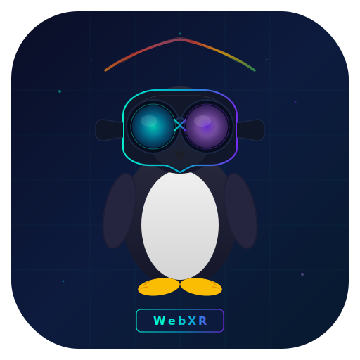
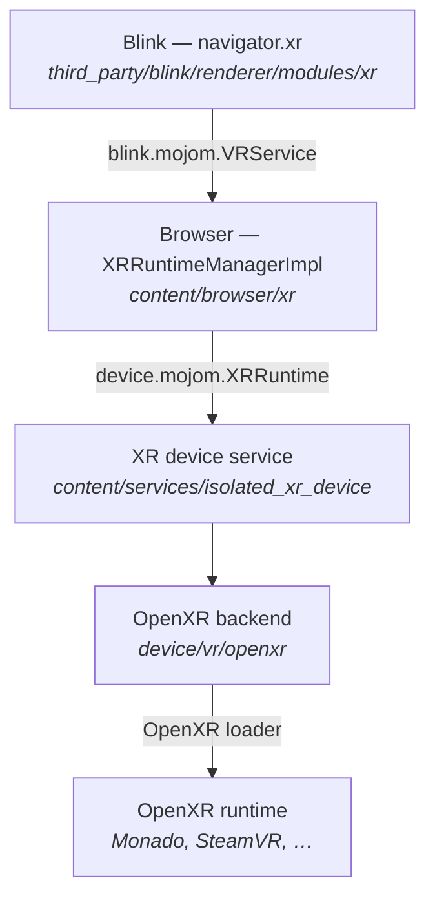
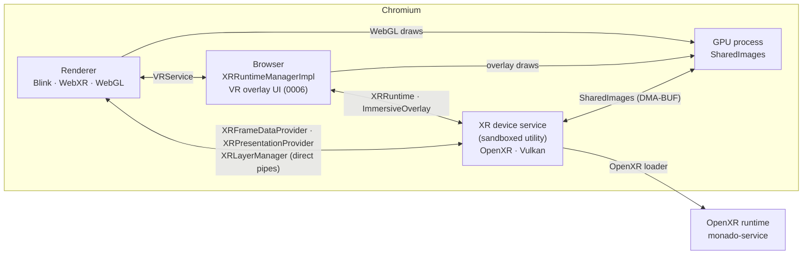
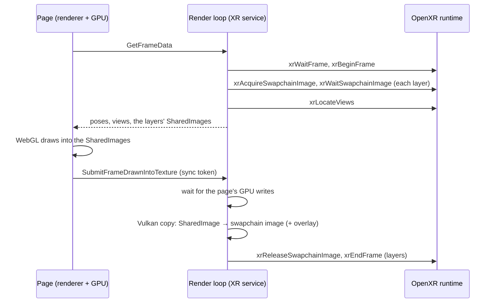
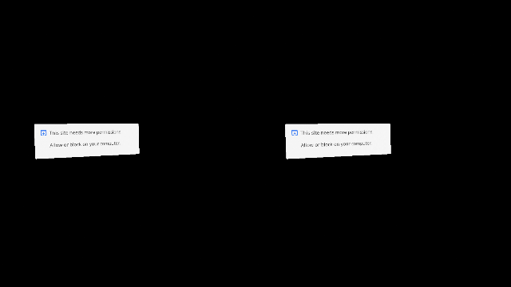
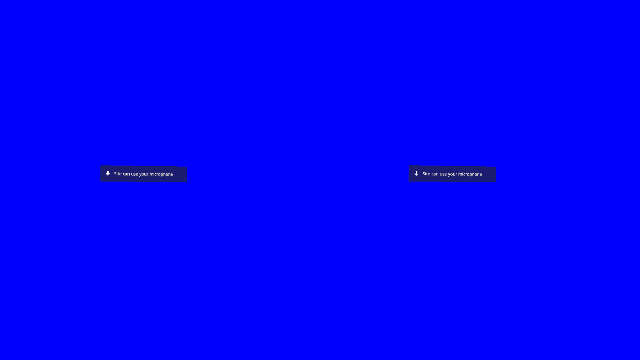
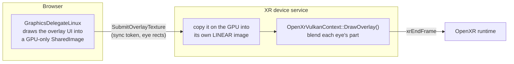
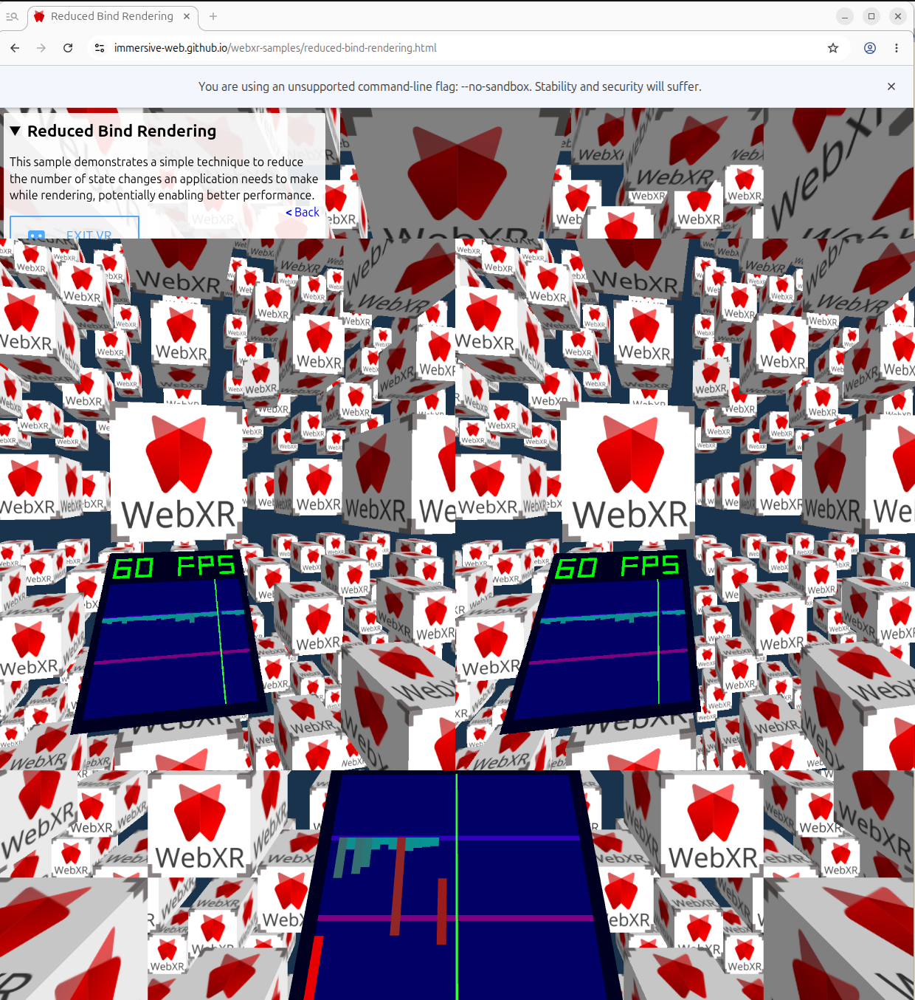

<p align="center">
  
</p>

# WebXR over OpenXR on Linux

WebXR for Linux builds of Chromium, through the OpenXR API, verified against
[Monado], the open-source reference OpenXR runtime.

The Linux OpenXR backend, its sandbox and its frame synchronization are part of
upstream Chromium. This repository carries the seven patches that are not
merged yet: more WebXR features on top of the backend, the in-headset browser
overlay, and turning OpenXR on by default.

[Monado]: https://monado.dev/

## Status

As of 2026-10-18. Milestones and dates are from
[chromiumdash](https://chromiumdash.appspot.com/schedule). A change ships in the
milestone that was on trunk when it landed.

### Merged upstream

| Change | Gerrit | Landed on main | Milestone | Linux stable |
| --- | --- | --- | --- | --- |
| vr: fix re-entrant OpenXR session-end crash | [8080622](https://crrev.com/c/8080622) | `8dab052`, 2026-07-17, r1663964 | M152 | Released in 152.0.7977.64 (2026-08-25) |
| vr: fix OpenXR session-child use-after-free on teardown | [8080621](https://crrev.com/c/8080621) | `9b872f8`, 2026-07-17, r1663970 | M152 | Released in 152.0.7977.64 (2026-08-25) |
| vr: add WebXR-over-OpenXR support on Linux | [8121052](https://crrev.com/c/8121052), reland [8210979](https://crrev.com/c/8210979) | `ff8f5db`, 2026-08-25, r1685828 | M154 | Released in 154.0.8037.57 (2026-09-22) |
| sandbox: skip uprobe/uretprobe in SandboxBPF.SyntheticPolicy | [8304617](https://crrev.com/c/8304617) | `0f1b5f6`, 2026-08-28, r1688157 | M154 | Released in 154.0.8037.57 (2026-09-22) |
| vr: run the XR device service in the sandbox on Linux | [8127854](https://crrev.com/c/8127854), reland [8441736](https://crrev.com/c/8441736) | `e0f937b`, 2026-09-25, r1705341 | M156 | Will be released in M156 (stable 2026-10-20) |
| vr: enable the OpenXR runtime on Linux | [8132979](https://crrev.com/c/8132979) | `71d17e1`, 2026-09-29, r1707175 | M157 | Will be released in M157 (stable 2026-11-03) |
| vr: let the XR sandbox read Flatpak's GPU drivers | [8498995](https://crrev.com/c/8498995) | `5153d78`, 2026-10-02, r1710366 | M157 | Will be released in M157 (stable 2026-11-03) |
| vr: avoid glFinish() in the OpenXR render loop on Linux | [8471692](https://crrev.com/c/8471692) | `acc4a4d`, 2026-10-12, r1717111 | M157 | Will be released in M157 (stable 2026-11-03) |

- M154 and M155 contain the backend, but nothing reaches it yet.
- From M157, WebXR over OpenXR works end to end with
  `--enable-features=OpenXR`. The feature is off by default on Linux.
- Two changes landed twice:
  - The core change was reverted the day it first landed (`de6885c`): its unit
    tests failed the Linux CFI bot's `cfi-icall` check.
  - The sandbox change was reverted once for a Cast build break (`5b3e4fb`).
- The SyntheticPolicy change fixes a sandbox test that newer kernels broke; the
  sandbox change needed it.

### Not merged yet: the patches in this repository

| Patch | Change | Gerrit | Review state | Earliest stable |
| --- | --- | --- | --- | --- |
| `0001` | vr: support WebXR Layers with OpenXR on Linux | [8471693](https://crrev.com/c/8471693) | In review (patch set 13), two Code-Review +1 | M158 (2026-11-17) if it lands before the M158 branch point on 2026-10-26, else M159 (2026-12-08) |
| `0002` | webxr: support frame rate control with OpenXR | [8473130](https://crrev.com/c/8473130) | In review (patch set 12) | M158 or M159, as above |
| `0003` | webxr: add XRFrame.predictedDisplayTime | [8510029](https://crrev.com/c/8510029) | In review (patch set 11) | M158 or M159, as above |
| `0004` | webxr: add XRSession.trackedSources and XRInputSource.skipRendering | [8510030](https://crrev.com/c/8510030) | In review (patch set 11) | M158 or M159, as above |
| `0005` | webxr: support WebGPU sessions with OpenXR on Linux | [8510031](https://crrev.com/c/8510031) | In review (patch set 11) | M158 or M159, as above |
| `0006` | vr: show the WebXR browser overlay on Linux | — | Not uploaded yet | M159 (2026-12-08) at the earliest |
| `0007` | vr: enable OpenXR by default on Linux | — | Not uploaded yet; needs a launch decision by the OpenXR owners | After the launch review |

The Gerrit changes form one relation chain in this order.

## The patches

Apply `0001` through `0007` in order, on the base in [Base commits](#base-commits).

| Patch | What it adds | How to turn it on |
| --- | --- | --- |
| `0001` | WebXR Layers: projection, quad, cylinder and equirect layers through `XRWebGLBinding` | Request the `layers` feature |
| `0002` | `XRSession.frameRate`, `supportedFrameRates`, `updateTargetFrameRate()` and `frameratechange`, from `XR_FB_display_refresh_rate`, on every OpenXR platform | `--enable-blink-features=WebXRFrameRate` |
| `0003` | `XRFrame.predictedDisplayTime`, from OpenXR's predicted display time | `--enable-blink-features=WebXRSpecParity` |
| `0004` | `XRSession.trackedSources` for input sources without a primary action, and `XRInputSource.skipRendering` | `WebXRSpecParity`, and the `tracked-sources` session feature |
| `0005` | WebGPU sessions (`XRGPUBinding`) on Linux | `--enable-features=OpenXR,WebXRWebGPUBinding` |
| `0006` | The in-headset browser overlay: permission prompts and capture indicators | On with the session |
| `0007` | The `OpenXR` feature on by default on Linux, as on Windows | — |

How `0001`, `0005` and `0006` work is described under
[Architecture](#architecture).

## What works on Linux

- **`immersive-vr`** with any OpenXR runtime that supports
  `XR_KHR_vulkan_enable2`. Verified with Monado.
- **Controllers and hand tracking** come from the runtime's OpenXR input, as on
  other platforms.
- **`immersive-ar`** is offered when the runtime reports an additive or
  alpha-blend environment blend mode, as on Windows. This is not verified
  here; Monado's simulated HMD is opaque only.
- **Inline sessions** use the orientation-sensor runtime, as everywhere.
- **Rendering:** WebGL into the base layer, or into WebXR Layers (`0001`), and
  WebGPU (`0005`).
- **Sandbox:** the OpenXR service runs in its own sandbox.
- **Window systems:** X11 and Wayland.

## Architecture

### Where WebXR lives in Chromium

WebXR has a platform-independent top half and a platform-specific bottom half
under `device/vr/`:



| Platform | immersive-vr | immersive-ar | Graphics binding |
| --- | --- | --- | --- |
| Windows | OpenXR | OpenXR | `OpenXrGraphicsBindingD3D11` — Direct3D 11 |
| Android | OpenXR, or Cardboard | OpenXR, or ARCore | `OpenXrGraphicsBindingOpenGLES` — OpenGL ES |
| Linux | OpenXR | OpenXR, if the runtime has an AR blend mode | `OpenXrGraphicsBindingVulkan` — Vulkan |

The OpenXR platforms share `device/vr/openxr/`:

- `OpenXrRenderLoop` runs the frame loop on its own thread and talks to the
  page.
- `OpenXrApiWrapper` owns the `XrInstance`, the `XrSession` and the frame calls
  (`xrWaitFrame`, `xrBeginFrame`, `xrEndFrame`).
- `OpenXrPlatformHelper` creates instances and checks availability.
- `OpenXrGraphicsBinding` does the GPU interop, together with
  `OpenXrCompositionLayer` for each layer.

The Linux-specific code is in `device/vr/openxr/linux/`:

- `OpenXrPlatformHelperLinux` keeps one `XrInstance` alive to poll for the
  runtime every 5 s, and the session adopts it, since the loader allows one
  instance per process.
- `OpenXrGraphicsBindingVulkan` manages the shared images and the layers.
- `OpenXrVulkanContext` holds every raw Vulkan call: device creation, image
  import and export, fences, copies, and the overlay pipeline.

### Processes and Mojo pipes



- **Discovery.** The browser starts the XR device service only when OpenXR is
  enabled. The service polls the runtime every 5 s and registers it with
  `XRRuntimeManagerImpl` once a system is found. Only then does
  `isSessionSupported('immersive-vr')` resolve to true.
- **Session start.** `requestSession()` goes to the browser, which asks the
  service for a session. The service creates the `VkDevice` and the
  `XrSession`. The page then gets pipes that connect it directly to the
  service's render loop, for frame data, frame submission and layers. The
  browser gets the `ImmersiveOverlay` pipe for the in-headset UI.
- **Rendering.** The page draws into `SharedImage`s that the service shares
  with it, via the GPU process. No pixels cross a process boundary; only
  DMA-BUF handles and sync tokens do.

### The frame loop



The render loop answers the page's next `GetFrameData` only after the previous
frame is submitted, and `xrWaitFrame` inside it paces the page to the
runtime's display.

### Shared images

The page cannot draw into OpenXR swapchain images: they belong to the runtime
and have no exportable memory. Each layer therefore has one **intermediate
image** per swapchain image. It is a DMA-BUF that the GPU process knows as a
`SharedImage` and the XR service as a `VkImage`, and each frame the service
copies it into the swapchain image with `vkCmdCopyImage`.

The binding allocates the intermediate images in one of two ways:

| Path | Used | How |
| --- | --- | --- |
| GBM native pixmap | On Wayland | The service asks the GPU process for a `SharedImage` with `SCANOUT` buffer usage and imports its DMA-BUF into Vulkan with the buffer's DRM format modifier and plane layout. The GPU driver chooses the modifier, so tiled and compressed buffers work. |
| `LINEAR` export | On X11, where Ozone allocates no native buffers by default, and headless | The service allocates `VK_IMAGE_TILING_LINEAR` images with exportable memory, exports them as DMA-BUFs (modifier 0), and the GPU process imports them as `SharedImage`s. |

The swapchain format is the first of BGRA sRGB, BGRA UNORM, RGBA sRGB and RGBA
UNORM that the runtime offers, and the `SharedImage` format follows it, so
colors are never swizzled.

**Orientation.** WebGL output is bottom-up, while Vulkan and OpenXR images are
top-down. The runtime flips projection layers. It flips other layer types too
if it supports `XR_FB_composition_layer_image_layout`; otherwise the copy
flips them row by row. WebGPU output is already top-down and is not flipped.

**Layers (`0001`).** Each composition layer has its own swapchain and its own
intermediate images. Projection and quad layers are core OpenXR; cylinder and
equirect layers need `XR_KHR_composition_layer_cylinder` and
`XR_KHR_composition_layer_equirect2`. Cube layers are not supported, because
one 2D intermediate image cannot hold six faces. On Linux the `layers` feature
is offered whenever the binding supports layers, and a layer whose type is not
supported stays inactive.

**WebGPU (`0005`).** WebGPU cannot write to these DMA-BUF images, so an
`XRGPUBinding` projection layer draws into an image of its own. At the end of
the frame that image is copied, and scaled if needed, into the layer's shared
image over the raster interface.

### Frame synchronization

Before the copy, the XR service must know that the page's GPU work on the
image has finished. It uses the first of these that applies:

1. **GPU fence.** If the GL backend supports `GL_CHROMIUM_gpu_fence`, the
   service takes a fence for the page's sync tokens and makes Vulkan wait on it
   (a sync-file semaphore). Nothing blocks on the CPU.
2. **DMA-BUF write fence.** Otherwise it flushes, and once the GPU process has
   issued the page's commands it exports the fence the kernel attached to the
   DMA-BUF (`DMA_BUF_IOCTL_EXPORT_SYNC_FILE`, Linux 6.0 or newer). It imports
   that fence as a `VkFence` and waits on it if it is still pending.
3. **`glFinish()`.** If no write fence is pending, it falls back to
   `glFinish()` on its own context.

Which applies depends on the GPU process's ANGLE backend, and by default on
the window system (observed with AMD on Mesa):

| GPU process | `GL_CHROMIUM_gpu_fence` | Wait used |
| --- | --- | --- |
| `--use-angle=vulkan` (X11 or Wayland) | yes | GPU fence |
| Default on Wayland: ANGLE on OpenGL ES over EGL | yes | GPU fence |
| Default on X11: ANGLE on desktop OpenGL over GLX | no | DMA-BUF write fence, else `glFinish()` |

The defaults differ because `ui/gl/init/gl_display_initializer.cc` tries
ANGLE's desktop-GL display first. ANGLE implements it with GLX on X11 and
with EGL on Wayland. Mesa exposes `EGL_ANDROID_native_fence_sync`, which the
GPU fence needs, only on EGL.

### In-headset browser overlay (`0006`)

During an immersive session Chromium can show browser UI in the headset:
- a notification when a permission prompt is open on the desktop, where the
  user answers it;
- indicators while the page uses the camera, microphone, location and so on.

The browser draws this UI. Upstream Chromium did not show it on Linux: the
device dropped the overlay's Mojo pipe, so the browser never created the UI.
The patch adds the missing Linux parts.

<p align="center">
  
  <br>
  <em>A permission prompt hides the page; both eyes show the notification.</em>
</p>

<p align="center">
  
  <br>
  <em>A capture indicator drawn over the page's projection layer.</em>
</p>



- **Drawing.** `GraphicsDelegateLinux` draws the `chrome/browser/vr` scene with
  GLES2 over the GPU command buffer, like `GraphicsDelegateWin`, which it
  copies. Two things differ from Windows:
  - It clears the image every frame, because a frame without overlay elements
    draws nothing and would otherwise show the previous frame.
  - It allocates the `gles2_lib` thread-local key that the UI's GL calls use.
- **Sharing.** The browser's image is a plain GPU `SharedImage`, since
  Ozone/X11 has no native buffers to share by default. For each new overlay
  frame, the XR service copies it with `CopySubTextureCHROMIUM` into a `LINEAR`
  image the service exported itself, in the swapchain's format. It then waits
  for the copy with `glFinish()`, as the D3D11 binding does.
- **Compositing.** `DrawOverlay()` draws each eye's rectangle with a small
  Vulkan graphics pipeline (embedded SPIR-V). It blends with premultiplied
  alpha and samples in the swapchain's encoding, so with an sRGB swapchain the
  blend happens in linear space. Where the overlay goes:

  | Situation | Overlay drawn into |
  | --- | --- |
  | WebXR visible, base layer only | The base layer, over the page |
  | WebXR visible, the page has a projection layer | That projection layer, over the page |
  | WebXR visible, the page has only other layers | The base layer, cleared transparent, on top of the page's layers |
  | A prompt hides WebXR | The base layer, cleared opaque black |

- **Render loop.** A frame that was being sent to the page when the overlay
  hid WebXR keeps its shared images, because Blink requires them for every
  frame with an id.

### Sandbox

The XR device service runs in its own sandbox type, `kXrCompositing`, as on
Windows (upstream since M156). It forks from the unsandboxed zygote, and a
pre-sandbox hook prepares it before seccomp engages:

- **Library pre-loading.** The hook loads the OpenXR runtime and the Vulkan
  loader, drivers and implicit layers, with their dependencies, while the file
  system is still reachable. The loaders' later `dlopen()` calls then need no
  broad file access.
- **File broker.** It starts a broker that grants the runtime manifest, the
  runtime library, the directories the loader resolves, and the GPU device
  files.
  - `/dev/shm` is create-only, as in the GPU process.
  - SteamVR, recognized by its manifest, also gets read/write `/dev/shm` and
    its log directories.
  - Since M157 Flatpak's GPU driver paths are readable too.
- **Seccomp policy.** The GPU process's policy, plus `AF_UNIX` sockets,
  `flock` and `get_robust_list` for SteamVR, and `kill()` with signal 0 only.
- **Brokered sockets.** `connect()` and `bind()` go through the broker. It
  checks the socket name against a per-runtime list, so the service can reach
  only the active runtime's sockets.

A locally built `chrome` can still need `--no-sandbox` for Chromium's *base*
sandbox, which is separate from this. Ubuntu's
`kernel.apparmor_restrict_unprivileged_userns=1` blocks unprivileged user
namespaces for binaries without an AppArmor profile, and installed Chrome has
one. For a dev build:

```
# /etc/apparmor.d/chrome-webxr-dev
abi <abi/4.0>,
include <tunables/global>
profile chrome-webxr-dev /path/to/src/out/Default/chrome flags=(unconfined) {
  userns,
  @{exec_path} mr,
  include if exists <local/chrome-webxr-dev>
}
```

Load it with `sudo apparmor_parser -r /etc/apparmor.d/chrome-webxr-dev`, then run
without `--no-sandbox`.

## Build and run

### Base commits

| Component | Remote | Base |
| --- | --- | --- |
| Chromium | `https://chromium.googlesource.com/chromium/src.git` | `ce7b69d7c8d5bdd1b4d2814777fb5818865bb710` (main, 2026-10-18, r1721490, 158.0.8111.0) |
| Monado | `https://gitlab.freedesktop.org/monado/monado.git` | `v25.1.0` or newer (verified at `v25.1.0-849-gded98428a`) |

The patches also apply cleanly to main `269a3c8a64d27` (2026-10-18). On a newer
base, `git am --3way` usually resolves conflicts.

### Prerequisites

Packages (Debian/Ubuntu):

```bash
sudo apt install -y \
  build-essential git cmake ninja-build pkg-config python3 \
  libvulkan-dev libvulkan1 vulkan-tools mesa-vulkan-drivers \
  libegl-dev libgl-dev libglx-dev \
  libx11-dev libxcb1-dev libxrandr-dev libxinerama-dev \
  libwayland-dev wayland-protocols \
  libhidapi-dev libusb-1.0-0-dev libudev-dev \
  libbsd-dev libdbus-1-dev libsystemd-dev libglvnd-dev
```

You also need Chromium's [`depot_tools`] on `PATH`.

[`depot_tools`]: https://www.chromium.org/developers/how-tos/install-depot-tools/

### 1. Build and run Monado

```bash
git clone https://gitlab.freedesktop.org/monado/monado.git
cd monado
cmake -B build -G Ninja \
  -DCMAKE_BUILD_TYPE=RelWithDebInfo \
  -DXRT_HAVE_OPENGL=ON \
  -DXRT_HAVE_VULKAN=ON \
  -DXRT_FEATURE_SERVICE=ON
ninja -C build
```

Start the service and leave it running:

```bash
rm -f /run/user/$(id -u)/monado_comp_ipc
./build/src/xrt/targets/service/monado-service
```

With no headset attached, Monado uses its simulated HMD, so everything can be
tested without hardware. Point OpenXR applications at it:

```bash
export XR_RUNTIME_JSON=$PWD/build/openxr_monado-dev.json
```

Rebuild all of Monado when you update it: the service and the client library
must come from the same build, or clients get `XR_ERROR_RUNTIME_UNAVAILABLE`.

### 2. Fetch Chromium

```bash
mkdir chromium && cd chromium
fetch --nohooks chromium
cd src
git checkout ce7b69d7c8d5bdd1b4d2814777fb5818865bb710
gclient sync
./build/install-build-deps.sh
```

`gclient sync` fetches the OpenXR loader into `third_party/openxr` on Linux by
default.

### 3. Apply the patches

```bash
git am /path/to/chromium-webxr-linux/0*.patch
```

The patches do not change `DEPS`, so no second `gclient sync` is needed.

Without the patches, Chromium M157 or newer (beta now, stable on 2026-11-03)
runs WebXR over OpenXR with `--enable-features=OpenXR`, without the features
above.

### 4. Build Chromium

```bash
gn gen out/Default --args='is_debug=false is_component_build=true symbol_level=1'
autoninja -C out/Default chrome
```

OpenXR is part of the Linux build by default. The tests:

```bash
autoninja -C out/Default device_unittests vr_common_unittests
./out/Default/device_unittests --gtest_filter='OpenXr*'
```

### 5. Run and verify

With `monado-service` running:

```bash
XR_RUNTIME_JSON=/path/to/monado/build/openxr_monado-dev.json \
./out/Default/chrome \
  --use-angle=vulkan \
  --vmodule='*openxr*=1' --enable-logging=stderr \
  --user-data-dir=/tmp/chrome-xr-test-profile \
  "file:///path/to/chromium-webxr-linux/tests/webxr-test.html" \
  2>&1 | tee /tmp/chrome-xr.log
```

- Without patch `0007`, add `--enable-features=OpenXR`.
- `--use-angle=vulkan` is optional. It selects the GPU-fence path; see
  [Frame synchronization](#frame-synchronization).
- Add `--no-sandbox` only if Chromium's base sandbox does not start; see
  [Sandbox](#sandbox).

On the page:

1. The **immersive-vr supported** line turns green once the service has found
   the runtime, which takes up to 5 s. If it stays red, see
   [Troubleshooting](#troubleshooting).
2. Click **Enter VR**. Monado shows the page's dark-blue clear color.
3. Request a permission or start a capture from the page; each has a keyboard
   shortcut. The notification or indicator appears in the headset (`0006`).
   Answer the prompt in the desktop dialog.
4. Press `Esc` or click **Exit VR**.

The Immersive Web samples work too, for example
<https://immersive-web.github.io/webxr-samples/immersive-vr-session.html> and the
layers samples at <https://immersive-web.github.io/webxr-samples/layers-samples/>
(`0001`).

<p align="center">
  
  <br>
  <em>Immersive Web's <code>reduced-bind-rendering</code> sample rendering
  stereo through Chromium → OpenXR → Monado.</em>
</p>

Both `--ozone-platform=x11` and `--ozone-platform=wayland` work and render at
the same rate. They differ only in how the shared images are allocated; see
[Shared images](#shared-images). Monado's own window does not matter, since it
gets frames over its IPC socket.

### Troubleshooting

```bash
grep -iE 'openxr|xrCreate|XR_ERROR|xrGetSystem|vulkan' /tmp/chrome-xr.log
```

| Log line | Meaning | Fix |
| --- | --- | --- |
| `xrCreateInstance ... XR_ERROR_RUNTIME_UNAVAILABLE` | Runtime not running, or Monado's service and client from different builds | Start `monado-service`; rebuild all of Monado |
| `xrCreateInstance ... XR_ERROR_EXTENSION_NOT_PRESENT` | Runtime lacks `XR_KHR_vulkan_enable2` | Build Monado with `-DXRT_HAVE_VULKAN=ON` |
| `Failed to load libvulkan.so.1` | No Vulkan loader or driver | `sudo apt install libvulkan1 mesa-vulkan-drivers` |
| `xrGetSystem ... XR_ERROR_FORM_FACTOR_UNAVAILABLE` | No HMD | Connect one, or use Monado's simulated HMD |
| `GL_CHROMIUM_gpu_fence supported=0` | No GPU fence; the DMA-BUF fence or `glFinish()` is used | Normal on X11; `--use-angle=vulkan` for the GPU fence |

`chrome://webxr-internals` lists runtimes, sessions and errors. Enable *WebXR
Internals Debugging Page* in `chrome://flags` and *Internal Debugging Pages* at
the bottom of `chrome://chrome-urls` to open it.

## Known limitations

- **Overlay cost.** While the overlay is visible, each overlay frame is copied
  and waited for with `glFinish()`. That includes the first five seconds of
  every session, when Chromium shows its first-time indicators. Heavy scenes
  render slower during that time; an asynchronous wait would remove the cost.
- **Overlay placement.** The overlay is placed in front of the user when it
  appears and does not follow large head turns. Its text is the generic "This
  site needs more permissions", as on Windows.
- **No cube layers** on Linux, and cylinder and equirect layers only where the
  runtime has their extensions. Monado has no cube layers; SteamVR has none of
  the three.
- **NVIDIA proprietary driver: Wayland only.** NVIDIA's GL cannot render into
  `LINEAR` DMA-BUF imports, which is what X11 uses. With
  `--vmodule='openxr_graphics_binding_vulkan=1'`, `via GBM native pixmap` in
  the log means the usable path is in effect.

## Reporting issues

Please include:

- The Chromium base commit (`git log -1 --format=%H` in `chromium/src`) and the
  patches applied.
- The runtime and its version (for Monado, `git describe --tags`).
- The filtered log from [Troubleshooting](#troubleshooting).
- Your GPU and driver (`vulkaninfo --summary`).

## License

This repository (README, test page and patch files) is distributed under the
BSD 3-Clause license in [LICENSE](LICENSE), the license of Chromium itself. The
files inside the patches keep Chromium's copyright headers.
